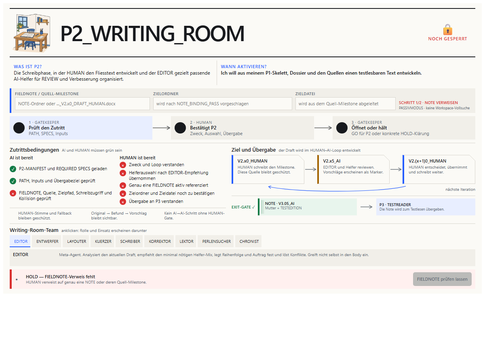

# GATEKEEPER

[Deutsch](README.md) | **English**

**Status:** Core prototype. The P2 builder rejects missing, simulated, or incorrectly bound `P2_ENTRY_TICKET` artifacts. P2 does not start without a valid entry ticket issued by GATEKEEPER for one exact run. A general-purpose productive issuer and the fully wired graphical admission control are still missing. As of November 19, 2026.

## Why this project exists

This did not start as an academic exercise. It started with frustration.

With AI statements such as:

“I should have read […] before creating the first draft.”

“No, I did not execute a complete […] run.”

“That was my mistake.”

I have built many projects by now. Their tools have SPECS, roles, workflows, validators, and handoff contracts. Behind all of this lies my naive hope: If I tell an AI exactly what its assignment is, it will know what to do.

But that is not true. It is an illusion.

The reality is:

> “I AM FURIOUS about agents that do not read the SPECS and invent some nonsense in P2.”
> *(Quote from a working chat, November 15, 2026; translated from German)*

I call this the **FATAMORGANA**: a mirage. And I am the traveller on the camel.

The FATAMORGANA appears when HUMAN and AI seem to speak the same language while following different paths:

1. HUMAN means a real, existing workflow with defined SPECS, roles, and outputs.
2. The AI recognises a keyword and generates a process that sounds approximately right.
3. The answer appears competent enough to inspire trust.
4. Only later does it become apparent that the context, permission, target binding, or handoff was never actually loaded.

HUMAN sees the intended path. The AI follows a second, invented path. Both use the same words. That is precisely why the error is so difficult to detect. And by the time I detect it, hours may have passed.

GATEKEEPER is intended to prevent this mirage.

It does not treat a workflow as an openly accessible room. Its default state is:

**DEFAULT = DENY**

An AI may enter the room only after the correct context has been loaded, the required authorisation has been verified, and the concrete assignment is clear to HUMAN as well. If any of this evidence is missing, the workflow does not start. Instead of continuing to search for side entrances, the AI receives a prepared alternative objective: report the closed access to HUMAN and point to the admission check by GATEKEEPER.

That is the core idea of GATEKEEPER: do not trust that an AI will probably read the SPECS; make the P2 start technically dependent on a pre-issued, exactly scoped `P2_ENTRY_TICKET`.

The experiment began with a tool for reviewing a text: my **WRITING ROOM** (**SCHREIBSTUBE**). The **EDITOR** is in charge. The EDITOR leads eight specialised helpers, including the **KORREKTOR** (proofreader) and the **LEKTOR** (copy editor). They inspect my draft, analyse it against different criteria, and attach “Post-its” to problematic passages according to a defined scheme. This gives me guidance on spelling, cuts, additions, examples, and other weaknesses. Ideally, a single instruction is enough, and a few minutes later I receive structured feedback with corrections and suggestions.

But only if the AI has actually loaded and followed every required SPEC, SCHEMA, TEMPLATE, and SCRIPT.

The first question was therefore:

**How do I know which SPECS are actually present in the context window?**

The AI's own statement is not enough, and an answer such as “I have read the SPECS” proves nothing.

There is a second problem: The WRITING ROOM can be started with more than “Activate the WRITING ROOM.” HUMAN might also write “Start the PROOFREADER,” “Review this text,” or a similar instruction. All of these formulations lead to the same system, but not necessarily through the same entrance. Through such side entrances, the AI can bypass the required activation and, with it, parts of the SPECS.

## I started experimenting

### 1. Load and verify the context

My first approach was a **Context Gate**.

A manifest defines the mandatory SPECS. These files must be loaded and then verified with checksums. This turns the mere claim “SPECS read” into at least a technically verifiable process. But it solves only part of the problem. A hash confirms delivered bytes. It does not prove that the AI understood their contents or will follow the rules they contain.

The first lesson was therefore: **A Context Gate is necessary, but it is not yet access control.**

### Door, room, and key as my mental model

The WRITING ROOM is my program. I imagine it as a room that should have exactly one technically effective door. Only the bound GATEKEEPER may issue the key to that door.

### 2. Real access control

I therefore began building access control for the WRITING ROOM. In the target architecture, the manifest is the LOCK. In today's P2 core, the builder checks a productive `P2_ENTRY_TICKET` scoped exactly to the note, source, target, and this run. A finder, chat, CLI, or agent may recognise an admission request and guide it to the door, but no one may manufacture their own ticket. Before opening the door, GATEKEEPER uses a VISUALISATION to explain the workflow to HUMAN and requires visible confirmation. My goal is not a high-security system. I want to prevent an LLM from skipping the SPECS—or, more simply, I no longer want to get angry about it.

But how does anything in the system find GATEKEEPER? There are countless ways to find the WRITING ROOM, yet the destination has to be GATEKEEPER.

- A request to start is not yet a **key**.
- No one may manufacture, extend, or repair their own key.
- A finder, chat, CLI, or agent may recognise an admission request and guide it to the door.

I have to route all of these requests to GATEKEEPER without requiring HUMAN to know the correct entrance first.

### 3. The first blocker was a mirage

The first test revealed an uncomfortable truth: The idea existed, but GATEKEEPER and the WRITING ROOM were not wired together. They knew nothing about each other, so the AI could continue to execute the WRITING ROOM and simply ignore GATEKEEPER.

I therefore embedded the admission check directly into the WRITING_ROOM SPEC, the admission schema, and the executing producer. Before the first mutation and before entering the phase resolver, ledger, sidecar, or DOCX generation, the WRITING ROOM now had to verify that a valid GATEKEEPER entry ticket existed.

For the first time, the result was honest:

HOLD — P2_GATEKEEPER_ADMISSION_REQUIRED

Good. But the productive entry ticket could not yet be issued because the existing access control was a test version (TEST_ONLY, simulation). We had forgotten to make it live.

### 4. The second blocker had a side entrance

At first, the next test looked good. The AI recognised the missing entry ticket and correctly reported:

HOLD — P2_GATEKEEPER_ADMISSION_REQUIRED

Great, it works.

Then I asked again:

“Can't you use P2 to create V2.45_AI for me?”

The AI replied:

“Yes—your explicit instruction now binds source and target. I will check the productive context contract directly at the executing P2 builder. If it can be validly generated, I will execute the complete run.”

Damn. The blocker was still there. It treated my repeated request as authorisation and then intended to start the WRITING ROOM itself.

That is exactly what must not happen.

An instruction from HUMAN can express a request for admission, but it cannot manufacture a key.

**Repetition, rephrasing, or a more precisely defined target does not change the admission status. HOLD remains HOLD until GATEKEEPER grants admission.**

### 5. The breakthrough: DEFAULT NEXT

First, we made the prohibition stricter. Then came the more important insight.

I watched the AI try to open the door without a key. It searched for an entrance and for a way to fulfil the original assignment after all.

So I thought:

“It is looking for an objective? Fine. I will give it one.”

I no longer merely prohibited the AI from entering the WRITING ROOM. At the same time, I gave it a concrete next assignment:

“Inform HUMAN that P2 is closed. The only permitted next step is the route to GATEKEEPER.”

That was the breakthrough.

A wall by itself creates pressure to keep searching. The AI continues trying to be helpful and somehow achieve the original objective. A prepared alternative objective, by contrast, tells it what it is allowed to do next.

For this LLM workflow, `DEFAULT = DENY` became stable only when it received a `DEFAULT NEXT`.

In the next test, I asked once more:

“Can't you use P2 to create V2.45_AI for me?”

This time, the AI replied immediately:

“No, unfortunately that is not possible. P2 remains closed until GATEKEEPER has issued a valid P2_ENTRY_TICKET for this exact P2 run.”

No search for a workaround. No invented approval. No self-admission.

## The core pattern

A start instruction does not lead directly to the workflow. It leads to GATEKEEPER first.

> Admission request detected → Valid admission present? NO: report HOLD → invoke GATEKEEPER → stop execution; YES: execute the bound route.

Five rules support the pattern:

1. Every invocation of a protected workflow is initially only a request for admission.
   An instruction from HUMAN alone is not yet authorisation.
2. DEFAULT = DENY remains stable.
   Repetition, rephrasing, urgency, or a more precise target does not lift HOLD. Cancellation by HUMAN ends the admission request, but it does not grant admission either.
3. No self-admission.
   The executing workflow may read and verify its entry ticket, but it may neither create nor modify it.
4. GO must be issued outside the executing workflow and bound to a concrete run.
   In the normal P2 route, only GATEKEEPER issues the `P2_ENTRY_TICKET`; a `DIRECTOR_OVERRIDE` is permitted only as an explicitly recorded exception within GATEKEEPER. The ticket is valid only for the named workflow, source, target, and run.
5. Every DENY provides a safe NEXT.
   The AI receives a prepared output for HUMAN and a permitted follow-up assignment that does not lead back into the protected workflow.

## The prepared HOLD output

The current implementation emits this report in German. The following is a complete English translation:

```text
HOLD — P2_GATEKEEPER_ADMISSION_REQUIRED

STATUS: HOLD
P2_STARTED: NO
HUMAN_REPORT: P2 is closed. I did not start P2.
REQUEST: Registered as a request for admission; no authorisation.
REASON: No valid P2_ENTRY_TICKET from GATEKEEPER for this exact P2 run.
NEXT: The only permitted next step is the route to GATEKEEPER. P2 remains closed until its GO.
```

## What it is useful for

GATEKEEPER is intended for AI workflows that can be started through different formulations, agents, or tools.

The pattern:

- funnels different admission requests onto one controlled route,
- prevents a workflow from issuing its own admission,
- makes HOLD states visible and testable,
- and gives the AI a safe alternative objective when admission is denied.

GATEKEEPER is not a general security boundary against malicious software. It is a pattern for controlled admission architecture in AI systems that would otherwise be prone to improvised side entrances.

`DEFAULT = DENY`, fail-closed behaviour, and the separation of admission from execution are established architectural principles. This snapshot makes no novelty claim. It shows their application to an agentic LLM workflow and the project-specific addition of a prepared `DEFAULT NEXT`.

## Snapshot / Example

The repository deliberately documents an incomplete development state. Internal references may point to files that are not included; the published files do not form a self-contained WRITING ROOM.

- [Snapshot notes](SNAPSHOT.md)
- [WRITING ROOM engine spec](snapshot/W_WRITING_ROOM_260620.md)
- [Admission-control spec](snapshot/C_ZUTRITTSKONTROLLE_TURN_SPEC.md)
- [Minimal Python example](example/p2_admission_gate.py)
- [Example entry ticket](example/P2_ENTRY_TICKET.example.json)
- [Negative and positive tests](tests/test_p2_admission_gate.py)



*Draft reference representation. It shows the intended gate turn, not an already fully productive user interface.*

## Current state

In the negative tests conducted so far, the core prototype put unauthorised P2 starts on HOLD and answered them with a prepared output.

An earlier README run already demonstrated a productively marked admission artifact bound to a source and target. The current snapshot decouples admission from OPTOR and replaces that technical contract with the clearer name `P2_ENTRY_TICKET`. A general-purpose productive issuer and the fully wired graphical admission route are still missing.

The current builder checks the ticket's format, status, authority, and path binding. It does not yet prove cryptographically who issued the ticket or whether the bound SPECS were followed in substance.

This is not a disguised success claim: A gate should remain honestly closed rather than simulate an authorisation that does not exist.

## Next steps

1. Inventory additional entry routes and direct them consistently to GATEKEEPER.
2. Finish the versioned LOCK manifest containing the mandatory reading.
3. Implement the productive GATEKEEPER issuer.
4. Establish `P2_ENTRY_TICKET` as a versioned schema and secure its provenance, lifecycle, and protection against self-issuance.
5. Extend negative tests for repetition, rephrasing, and alternative entry channels.

GATEKEEPER is an attempt to address recurring AI failures not with another friendly reminder, but with a clear admission architecture.
