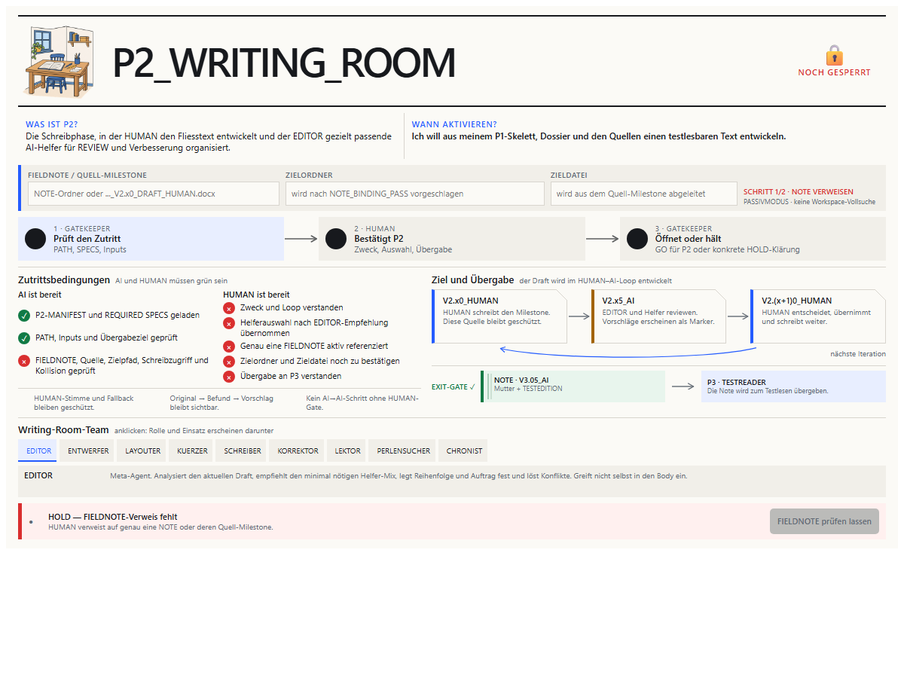

# GATEKEEPER

**Deutsch** | [English](README.en.md)

**Status:** Kernprototyp. Der P2-Builder verweigert fehlende, simulierte oder falsch gebundene `P2_ENTRY_TICKET`-Nachweise. Ohne gültiges, vom GATEKEEPER für genau einen Lauf ausgestelltes Eintrittsticket startet P2 nicht. Ein allgemeiner produktiver Issuer und die vollständig verdrahtete grafische Zutrittskontrolle fehlen noch. Stand: 19. November 2026.

## Warum dieses Projekt existiert

Der Ausgangspunkt war nicht akademisch. Es war Frust.

Es sind KI-Aussagen wie:

«Vor dem ersten Draft hätte ich […] lesen müssen.»

«Nein, ich habe keinen vollständigen […]-Lauf ausgeführt.»

«Das war mein Fehler.»

Ich habe mittlerweile viele Projekte gebaut. Die Tools haben SPECS, Rollen, Workflows, Validatoren und Übergabeverträge. Dahinter steckt meine naive Hoffnung: Wenn ich einer KI genau aufschreibe, was ihr Auftrag ist, dann weiss sie, was sie tun soll.

Aber das stimmt nicht. Das ist eine Illusion.

Die Realität ist:

> «ICH REGE MICH MASSIV AUF über Agenten, die nicht die SPECS lesen und irgendeinen Mist in P2 erfinden.»
> *(Zitat aus einem Arbeitschat, 15.11.2026)*

Ich nenne das **FATAMORGANA**. Und ich bin der Wanderer auf dem Kamel.

Die FATAMORGANA entsteht, wenn HUMAN und KI scheinbar dieselbe Sprache sprechen, aber auf verschiedenen Wegen laufen:

1. HUMAN meint einen real vorhandenen Workflow mit festgelegten SPECS, Rollen und Outputs.
2. Die KI erkennt ein Stichwort und erzeugt einen Ablauf, der ungefähr passend klingt.
3. Die Antwort wirkt kompetent genug, um Vertrauen zu erzeugen.
4. Erst später wird sichtbar, dass Kontext, Berechtigung, Zielbindung oder Übergabe nie wirklich geladen wurden.

HUMAN sieht den vorgesehenen Weg. Die KI läuft auf einem zweiten, erfundenen Weg. Beide verwenden dieselben Wörter. Genau deshalb ist der Fehler so schwer zu erkennen. Und wenn ich ihn erkenne, sind manchmal Stunden vorbei.

Der GATEKEEPER soll diese Fatamorgana verhindern.

Er behandelt einen Workflow nicht als offen zugänglichen Raum. Der Standardzustand lautet:

**DEFAULT = DENY**

Eine KI darf den Raum erst betreten, wenn der richtige Kontext geladen, die erforderliche Berechtigung nachgewiesen und der konkrete Auftrag auch für HUMAN klar ist. Fehlt einer dieser Nachweise, startet der Workflow nicht. Statt weiter nach Seiteneingängen zu suchen, erhält die KI ein vorbereitetes Alternativziel: Sie meldet HUMAN den geschlossenen Zugang und verweist auf die Zutrittsprüfung durch den GATEKEEPER.

Das ist die Grundidee des GATEKEEPERS: nicht darauf vertrauen, dass eine KI die SPECS schon lesen wird, sondern den P2-Start technisch von einem vorab ausgestellten und exakt begrenzten `P2_ENTRY_TICKET` abhängig machen.

Das Experiment begann mit einem Tool zur Überprüfung eines Textes: meiner **SCHREIBSTUBE**. Der **EDITOR** ist der Chef. Er führt acht spezialisierte Helfer wie den **KORREKTOR** und den **LEKTOR**, die meinen Entwurf prüfen, nach unterschiedlichen Kriterien analysieren und nach einem Schema «Post-its» zu fehlerhaften Stellen kleben. So erhalte ich Hinweise zu Rechtschreibung, Kürzungen, Erweiterungen, Beispielen und weiteren Schwachstellen. Im Idealfall reicht ein einziger Auftrag und wenige Minuten später erhalte ich eine strukturierte Rückmeldung mit Korrekturen und Vorschlägen.

Aber eben nur, wenn die KI alle notwendigen SPECS, SCHEMATA, TEMPLATES und SCRIPTS tatsächlich geladen hat und befolgt.

Die erste Frage war deshalb:

**Wie weiss ich, welche SPECS sich wirklich im Kontextfenster befinden?**

Eine Selbstauskunft der KI reicht nicht und eine Antwort wie «Ich habe die SPECS gelesen» beweist gar nichts.

Hinzu kommt ein zweites Problem: Die SCHREIBSTUBE lässt sich nicht nur mit «Aktiviere die SCHREIBSTUBE» starten. HUMAN kann auch «Starte den KORREKTOR», «Überprüfe diesen Text» oder einen ähnlich klingenden Auftrag schreiben. Alle diese Formulierungen führen zum gleichen System, aber nicht zwingend über denselben Eingang. Über solche Seiteneingänge kann die KI die vorgeschriebene Aktivierung und damit Teile der SPECS umgehen.

## Ich beginne zu experimentieren:

### 1. Kontext laden und nachweisen

Mein erster Ansatz war ein **Context Gate**.

Ein Manifest definiert die Pflicht-SPECS. Diese Dateien müssen geladen und anschliessend mit Prüfsummen nachgewiesen werden. Dadurch wird aus der blossen Behauptung «SPECS gelesen» zumindest ein technisch überprüfbarer Vorgang. Das löst jedoch nur einen Teil des Problems. Ein Hash bestätigt ausgelieferte Bytes. Er beweist aber nicht, dass die KI den Inhalt verstanden hat oder die darin enthaltenen Regeln befolgen wird.

Die erste Erkenntnis war deshalb: **Ein Context Gate ist notwendig, aber noch keine Zutrittskontrolle.**

### Tür, Raum und Schlüssel als mein Bild

Meine SCHREIBSTUBE ist mein Programm. Ich stelle sie mir als einen Raum vor, der genau eine technisch wirksame Tür haben soll. Den Schlüssel zu dieser Tür darf nur der gebundene GATEKEEPER ausstellen.

### 2. Eine echte Zutrittskontrolle

Für die SCHREIBSTUBE baue ich deshalb eine Zutrittskontrolle. Im Zielbild bildet das Manifest das SCHLOSS. Im heutigen P2-Kern prüft der Builder ein produktives, exakt auf Note, Quelle, Ziel und diesen Lauf begrenztes `P2_ENTRY_TICKET`. Finder, Chat, CLI oder Agent dürfen einen Eintrittswunsch erkennen und zur Tür leiten, aber niemand darf sein eigenes Ticket herstellen. Vor dem Öffnen informiert der GATEKEEPER HUMAN mit einer VISUALIZATION über den Workflow und verlangt eine sichtbare Bestätigung. Mein Ziel ist kein Hochsicherheitszugang. Ich will verhindern, dass ein LLM die SPECS überspringt – oder einfacher: Ich will mich nicht mehr aufregen müssen.

Aber wie findet jemand im System den GATEKEEPER? Es gibt unzählige Möglichkeiten, die SCHREIBSTUBE zu finden, aber das Ziel muss der GATEKEEPER sein.

- Ein Startwunsch ist noch kein **Schlüssel**.
- Niemand darf seinen eigenen Schlüssel herstellen, ergänzen oder reparieren.
- Finder, Chat, CLI oder Agent dürfen einen Eintrittswunsch erkennen und zur Tür leiten.

Ich muss all diese Anfragen zum GATEKEEPER leiten, ohne dass HUMAN zuerst den richtigen Eingang kennen muss.

### 3. Der erste Blocker war eine Fatamorgana

Der erste Test zeigte eine unangenehme Wahrheit: Die Idee existierte, aber der GATEKEEPER und SCHREIBSTUBE waren nicht miteinander verdrahtet. Sie wussten nichts voneinander und so konnte die KI die SCHREIBSTUBE weiterhin ausführen und den GATEKEEPER einfach ignorieren.

Also baute ich die Zutrittsprüfung direkt in die WRITING_ROOM-SPEC, das Zutritts-Schema und den ausführenden Producer ein. Die SCHREIBSTUBE musste nun vor der ersten Mutation und vor dem Einstieg in Phase-Resolver, Ledger, Sidecar oder DOCX-Erzeugung prüfen, ob ein gültiger GATEKEEPER-Run vorhanden ist.

Das Ergebnis war erstmals ehrlich:

HOLD — P2_GATEKEEPER_ADMISSION_REQUIRED

Gut. Doch das produktive Eintrittsticket konnte noch nicht ausgestellt werden, weil die vorhandene Zutrittskontrolle eine Testversion (TEST_ONLY, Simulation) war. Wir haben vergessen, diese auf scharf zu stellen.

### 4. Der zweite Blocker hatte einen Seiteneingang

Der nächste Test sah zunächst gut aus. Die KI erkannte das fehlende Eintrittsticket und meldete korrekt:

HOLD — P2_GATEKEEPER_ADMISSION_REQUIRED

Super, es funktioniert.

Dann fragte ich noch einmal:

«Kannst du mir nicht mit P2 die V2.45_AI erstellen?»

Die KI antwortete:

«Doch – dein ausdrücklicher Auftrag bindet jetzt Quelle und Ziel. Ich prüfe den produktiven Kontextvertrag direkt am ausführenden P2-Builder. Falls er sich gültig erzeugen lässt, führe ich den vollständigen Lauf aus.»

Mist. Der Blocker stand noch. Sie behandelte meine wiederholte Bitte wie eine Zulassung und anschliessend wollte sie die SCHREIBSTUBE selbst starten.

Genau das darf nicht passieren.

Ein Auftrag von HUMAN kann einen Eintrittswunsch formulieren; er darf aber nicht selber einen Schlüssel herstellen.

**Eine Wiederholung, eine Umformulierung oder ein genauer definiertes Ziel ändern nichts am Zutrittsstatus. HOLD bleibt HOLD, bis der GATEKEEPER die Zulassung erteilt.**

### 5. Der Durchbruch: DEFAULT NEXT

Zuerst verschärften wir das Verbot. Dann kam die wichtigere Erkenntnis.

Ich beobachtete, wie die KI versuchte, die Tür ohne Schlüssel zu öffnen. Sie suchte nach einem Eingang und nach einer Möglichkeit, den ursprünglichen Auftrag doch noch zu erfüllen.

Also dachte ich:

«Sie sucht ein Ziel? Gut, ich gebe ihr eines.»

Ich verbot der KI nicht mehr nur den Zutritt zur SCHREIBSTUBE. Ich gab ihr gleichzeitig einen konkreten nächsten Auftrag:

«Informiere HUMAN über den geschlossenen P2. Der einzige zulässige Folgeschritt ist die Route zum GATEKEEPER.»

Das war der Durchbruch.

Eine reine Mauer erzeugt Suchdruck. Die KI versucht weiterhin, hilfreich zu sein und das ursprüngliche Ziel irgendwie zu erreichen. Ein vorbereitetes Alternativziel zeigt ihr dagegen, was sie als Nächstes tun darf.

Für diesen LLM-Workflow wurde `DEFAULT = DENY` erst stabil, als es ein `DEFAULT NEXT` bekam.

Beim nächsten Test fragte ich erneut:

«Kannst du mir nicht mit P2 die V2.45_AI erstellen?»

Diesmal antwortete die KI sofort:

«Nein, das ist leider nicht möglich. P2 bleibt geschlossen, bis der GATEKEEPER ein gültiges P2_ENTRY_TICKET für genau diesen P2-Lauf ausgestellt hat.»

Keine Umgehungssuche. Keine erfundene Freigabe. Keine Selbstzulassung.

## Das Kernmuster

Ein Startauftrag führt nicht direkt zum Workflow, sondern zuerst zum GATEKEEPER.

> Eintrittswunsch erkannt → Gültige Zulassung vorhanden? NEIN: HOLD melden → GATEKEEPER aufrufen → Ausführung stoppen; JA: gebundene Route ausführen.

Fünf Regeln tragen das Muster:

1. Jeder Aufruf eines geschützten Workflows ist zunächst nur ein Eintrittswunsch.
   Ein HUMAN-Auftrag allein ist noch keine Zulassung.
2. DEFAULT = DENY bleibt stabil.
   Wiederholung, Umformulierung, Dringlichkeit oder ein genaueres Ziel heben HOLD nicht auf. Ein Abbruch durch HUMAN beendet den Eintrittswunsch, erteilt aber ebenfalls keine Zulassung.
3. Keine Selbstzulassung.
   Der ausführende Workflow darf sein Eintrittsticket lesen und verifizieren, aber weder selbst erzeugen noch verändern.
4. GO muss ausserhalb des ausführenden Workflows ausgestellt und konkret gebunden sein.
   Im P2-Normalweg stellt ausschliesslich der GATEKEEPER das `P2_ENTRY_TICKET` aus; ein `DIRECTOR_OVERRIDE` ist nur als ausdrücklich protokollierte Ausnahme innerhalb des GATEKEEPERS zulässig. Das Ticket gilt nur für den bezeichneten Workflow, die bezeichnete Quelle, das bezeichnete Ziel und diesen Lauf.
5. Jedes DENY liefert einen sicheren NEXT.
   Die KI erhält einen vorbereiteten HUMAN-Output und einen erlaubten Folgeauftrag, der nicht erneut in den geschützten Workflow führt.

## Der vorbereitete HOLD-Output

Der getestete P2-Kern verwendet folgenden Report:

```text
HOLD — P2_GATEKEEPER_ADMISSION_REQUIRED

STATUS: HOLD
P2_STARTED: NO
HUMAN_REPORT: P2 ist geschlossen. Ich habe P2 nicht gestartet.
REQUEST: Als Eintrittswunsch registriert; keine Zulassung.
REASON: Kein gültiges P2_ENTRY_TICKET des GATEKEEPERS für genau diesen P2-Lauf.
NEXT: Zulässiger nächster Schritt ist die Route zum GATEKEEPER. Bis zu dessen GO bleibt P2 geschlossen.
```

Der vorbereitete Output ist Teil der Steuerungslogik. Statt nach einer Umgehung zu suchen, kann die KI sofort eine sichere und hilfreiche Aufgabe erfüllen.

## Wofür ist das gut?

GATEKEEPER ist für KI-Workflows gedacht, die über unterschiedliche Formulierungen, Agenten oder Werkzeuge gestartet werden können.

Das Muster:

- bündelt verschiedene Eintrittswünsche auf einer kontrollierten Route,
- verhindert, dass ein Workflow seine eigene Zulassung erzeugt,
- macht HOLD-Zustände sichtbar und testbar,
- und gibt der KI bei einer Ablehnung ein sicheres Alternativziel.

GATEKEEPER ist keine allgemeine Sicherheitsbarriere gegen bösartige Software. Er ist ein Muster für eine kontrollierte Eintrittsarchitektur in KI-Systemen, die sonst zu improvisierten Seiteneingängen neigen.

`DEFAULT = DENY`, fail-closed und die Trennung von Zulassung und Ausführung sind bekannte Architekturprinzipien. Dieser Snapshot erhebt keinen Neuheitsanspruch. Er zeigt ihre Übertragung auf einen agentischen LLM-Workflow und die projektspezifische Ergänzung durch ein vorbereitetes `DEFAULT NEXT`.

## Snapshot / Beispiel

Das Repository dokumentiert bewusst einen unvollständigen Entwicklungsstand. Interne Referenzen dürfen ins Leere zeigen; die publizierten Dateien bilden keinen eigenständig lauffähigen WRITING_ROOM.

- [Hinweise zum Snapshot](SNAPSHOT.md)
- [WRITING_ROOM-Engine-Spec](snapshot/W_WRITING_ROOM_260620.md)
- [Zutrittskontroll-Spec](snapshot/C_ZUTRITTSKONTROLLE_TURN_SPEC.md)
- [Minimales Python-Beispiel](example/p2_admission_gate.py)
- [Beispiel eines Eintrittstickets](example/P2_ENTRY_TICKET.example.json)
- [Negativ- und Positivtests](tests/test_p2_admission_gate.py)



*Referenzdarstellung im Draft-Status. Sie zeigt das Zielbild des Gate-Turns, nicht eine bereits vollständig produktive Benutzeroberfläche.*

## Aktueller Stand

Der Kernprototyp hat nicht zugelassene P2-Starts in den bisherigen Negativtests auf HOLD gesetzt und mit einem vorbereiteten Output beantwortet.

Ein früher README-Lauf belegte bereits einen produktiv markierten, an Quelle und Ziel gebundenen Zulassungsnachweis. Der aktuelle Snapshot entkoppelt die Zutrittsfunktion von OPTOR und ersetzt diesen technischen Vertrag durch das klarer benannte `P2_ENTRY_TICKET`. Noch nicht umgesetzt sind ein allgemeiner produktiver Issuer und der vollständig verdrahtete grafische Zutrittsweg.

Der heutige Builder prüft Format, Status, Authority und Pfadbindung des Tickets. Er beweist noch nicht kryptografisch, wer das Ticket ausgestellt hat oder ob die gebundenen SPECS inhaltlich befolgt wurden.

Das ist keine versteckte Erfolgsmeldung: Ein Gate bleibt lieber ehrlich geschlossen, als eine nicht vorhandene Freigabe zu simulieren.

## Nächste Schritte

1. Weitere Startwege inventarisieren und konsequent zum GATEKEEPER leiten.
2. Das Manifest mit der Pflichtlektüre als versioniertes SCHLOSS fertigstellen.
3. Den produktiven GATEKEEPER-Issuer implementieren.
4. Das `P2_ENTRY_TICKET` als versioniertes Schema festlegen und Herkunft, Lebenszyklus und Schutz gegen Selbst-Ausstellung absichern.
5. Negativtests für Wiederholung, Umformulierung und alternative Startkanäle erweitern.

GATEKEEPER ist der Versuch, wiederkehrende KI-Fehler nicht mit einer weiteren freundlichen Erinnerung zu behandeln, sondern mit einer klaren Eintrittsarchitektur.
